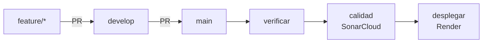

# Integración y despliegue continuos

Entregable «CI/CD inicial con GitHub Actions». El pipeline está en
[`.github/workflows/ci.yml`](../.github/workflows/ci.yml).

## Flujo

| Evento | `verificar` | `calidad` | `desplegar` |
|---|:---:|:---:|:---:|
| Pull request hacia `develop` o `main` | ✅ | ✅ si `verificar` pasa | — |
| Push (merge) a `develop` | ✅ | — | — |
| Push (merge) a `main` | ✅ | ✅ si `verificar` pasa | ✅ si ambos pasan |

Un push nuevo cancela la ejecución en curso de la misma rama, salvo en `main`, para no
cortar un despliegue. El token del workflow solo tiene permiso de lectura.

### `verificar`: Build y verificación (JDK 21)

`./mvnw -B clean verify`, igual que en local:

- pruebas del equipo de desarrollo (sufijo `Test`) contra PostgreSQL real con
  Testcontainers y las migraciones de Flyway aplicadas;
- verificación de la modularidad con Spring Modulith (`ModularidadTest`);
- cobertura de líneas con JaCoCo: falla por debajo del 85 %;
- reporte de Checkstyle, todavía sin romper el build.

Las pruebas funcionales de QA (sufijo `IT`, perfil `casos-qa-sprint1`) no corren aquí.

Si falla, los informes de Surefire quedan descargables 7 días como artefacto
`informes-de-pruebas`.

### `calidad`: Quality Gate SonarCloud

Reutiliza las clases compiladas y el `jacoco.xml` que dejó `verificar`, sin recompilar ni
repetir pruebas, y analiza con `sonar.qualitygate.wait=true`: el job espera el veredicto
y falla si el Quality Gate no pasa. Se usa el Quality Gate *Sonar way*, que evalúa el
código nuevo:

| Condición sobre código nuevo | Valor |
|---|---|
| Cobertura | ≥ 80 % |
| Líneas duplicadas | ≤ 3 % |
| Maintainability, Reliability y Security Rating | A |
| Security Hotspots revisados | 100 % |

**Por qué no corre en push a `develop`.** El plan gratuito de SonarCloud solo entrega el
Quality Gate de la rama principal del proyecto en Sonar y de los pull requests; para
cualquier otra rama responde *«Organization is not allowed to access data from non main
branches»* y el job falla aunque el análisis se haya hecho. La rama principal en Sonar es
`main`, porque es lo que está en producción y lo que muestran las insignias del README.
`develop` no queda sin control: todo lo que entra en ella llega por un PR, y los PR
siempre se analizan.

### `desplegar`: Desplegar en Render

Solo en push a `main` y solo si `verificar` y `calidad` pasaron. Llama al *deploy hook* de
Render, que reconstruye la imagen desde el `Dockerfile` del commit. Corre en el entorno de
GitHub `produccion`, que guarda el secreto, solo acepta la rama `main` y registra cada
despliegue en la pestaña **Environments**.

Producción: <https://supplychain-api-dzmc.onrender.com/swagger-ui.html>

## Configuración que se hace una sola vez

Estos pasos se hacen en los paneles de GitHub, Render y SonarCloud, con permisos de
administrador del repositorio.

### 1. Render

1. Servicio `supplychain-api-dzmc` → **Settings → Build & Deploy → Deploy Hook**: copiar la
   URL. Es secreta: quien la tenga puede desplegar.
2. **Health Check Path**: `/actuator/health`.
3. **Auto-Deploy → Off**, una vez el job `desplegar` esté en `main`. Si queda activo,
   Render despliega cada push a `main` aunque las pruebas fallen, y además dos veces.

Variables de entorno del servicio: `SPRING_DATASOURCE_URL`, `SPRING_DATASOURCE_USERNAME`,
`SPRING_DATASOURCE_PASSWORD`, `JWT_SECRET`, `MFA_ENCRYPTION_KEY` y `CORS_ALLOWED_ORIGINS`.
Render inyecta `PORT`.

### 2. GitHub: entorno `produccion`

1. **Settings → Environments → New environment** → `produccion`.
2. **Add environment secret**: `RENDER_DEPLOY_HOOK` con la URL del paso 1.
3. **Deployment branches and tags** → *Selected branches* → `main`.

### 3. SonarCloud

1. sonarcloud.io → **Analyze new project** → organización `dalev10` → proyecto
   `Dalev10_ZARA-code-factory` (plan Free, repositorio público).
2. **Administration → Analysis Method**: desactivar **Automatic Analysis**; si queda activo,
   el análisis desde el pipeline falla.
3. **Administration → Branches and Pull Requests**: la rama principal debe llamarse `main`.
   Sonar toma como principal la primera rama que analiza; si fue otra, se elimina la rama
   `main` que haya quedado como secundaria y se renombra la principal a `main`.
4. **My Account → Security → Generate Token** (*Project Analysis Token*).
5. GitHub → **Settings → Secrets and variables → Actions** → secreto `SONAR_TOKEN`.
6. El mismo secreto en **Settings → Secrets and variables → Dependabot**: los PR de
   Dependabot no ven los secretos de Actions y sin él su job `calidad` falla.

Si falta un secreto, el job correspondiente falla con un mensaje que apunta a este
documento, en vez de terminar en verde sin haber hecho nada.

### 4. GitHub: seguridad del repositorio

En **Settings → Advanced Security**: Dependabot alerts y security updates, CodeQL con la
configuración por defecto (Java/Kotlin y Actions), secret scanning con push protection y
private vulnerability reporting.

### 5. GitHub: protección de ramas

**Settings → Rules → Rulesets**, para `main` y `develop`:

- exigir pull request (`develop`: 1 aprobación; `main`: 0);
- exigir que pasen **`Build y verificación (JDK 21)`** y **`Quality Gate SonarCloud`**.
  Solo aparecen en la lista después de que el pipeline haya corrido una vez;
- bloquear *force push*.

## Lo que el pipeline todavía no hace

| Control | Motivo |
|---|---|
| Publicar la imagen en un registro (GHCR) | Render reconstruye desde el repositorio; una imagen publicada no sería la que corre |
| Prueba de humo después del despliegue | El deploy hook es asíncrono; Render ya valida `/actuator/health` antes de enviar tráfico |
| Entorno de integración desde `develop` | Requiere un segundo servicio de Render y otra base |
| Pruebas funcionales de QA (`*IT`) | Corren a pedido con `-P casos-qa-sprint1` |
